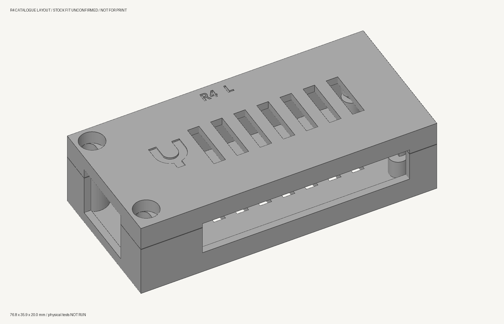

# USB endpoint housing

The case holds one **Radxa ZERO 3E V1.2**. R4 replaces the two rejected
prints with a rectangular shell, a sliding joint and recessed M3 screws.
It is a **design candidate, not a released print**. Physical fit and
strength tests have not been run.

[R4 assembly and test plan](../../hardware/usb-housing/r4/README.md) ·
[Assembly drawings](../../hardware/usb-housing/r4/assembly.pdf)

## R4: slots and screws

The lid lowers into locating slots, then slides into two retaining pockets
at the back. Two screws at the Ethernet end hold it closed and prevent
the slide from reversing. Opening reverses that sequence: remove both
screws, slide the lid back, then lift it off.

The shell follows the loaded board's rectangular outline. Its fastener
bosses stay inside the case; there are no projecting ears or turrets.
The outer dimensions are **76.8 × 35.9 × 20 mm**, including the shell
around the Ethernet connector's overhang.
The screws do not pass through the PCB. Internal pads support the board
and two small locating pegs register it.

The hardware is the same type recorded in Lacuna's stock: **M3 socket-head
screws and RX M3×5.7 heat-set inserts**. R4 uses two M3×8 screws, with
recessed heads and clearance for a hex driver. Install the inserts in the
empty base and let it cool before fitting the board.

The nominal insert profile comes from the
[Ruthex manufacturer datasheet](https://www.igo3d.com/mediafiles/Sonstiges/Ruthex/ruthex_Datenblatt_RX-Serie.pdf):
4.6 mm outer diameter, 5.7 mm length and a 4.0 mm pilot hole. The actual
stock still needs to be matched to that part. Printed-hole shrinkage,
insert setting and screw fit need physical checks.

## Before another full case print

Use the same Lacuna mesh, print-support and assembly-clearance tools,
with the actual R4 geometry. Those checks can find unsupported features
and modeled collisions. They cannot establish the fit of printed plastic,
installed inserts or actual cables.

First qualify small samples of the actual joints: the front screw,
insert and locating slot; then the rear tab and retaining pocket.
Check screw engagement and head recess, the full slide movement, repeated
opening and closing, and retention under a measured separating load.
Only then prepare a complete case for print review. The full case also
needs board, cable, Ethernet latch and thermal checks before use.

## Rejected and earlier revisions

**Do not print R1 or R3 again.** The owner rejected both printed cases;
the exact failure dimensions were not recorded. Their earlier digital
approvals do not qualify R4 or establish that those assemblies worked.
Lacuna's retired-job guard blocks the known rejected meshes and jobs.

| Revision | Status | Record |
|---|---|---|
| R3 | Printed; owner reported assembly failure | [Owner result](../../hardware/usb-housing/r3/owner-result.json), [historical assembly guide](../../hardware/usb-housing/r3/README.md) |
| R2 | Branding revision; not printed | [Native CAD](../../hardware/usb-housing/r2/housing.scad), [digital validation](../../hardware/usb-housing/r2/validation.json) |
| R1 | Printed; owner rejected | [Original dispatch record](../../hardware/usb-housing/print.json) |

R1–R3 used M2.5 screws and captive nuts. Their fasteners, projecting lugs
and bore-cleanup instructions do not apply to R4. The [USB hardware
design](USB-ENDPOINT.md) describes the two-box product this case belongs to.
