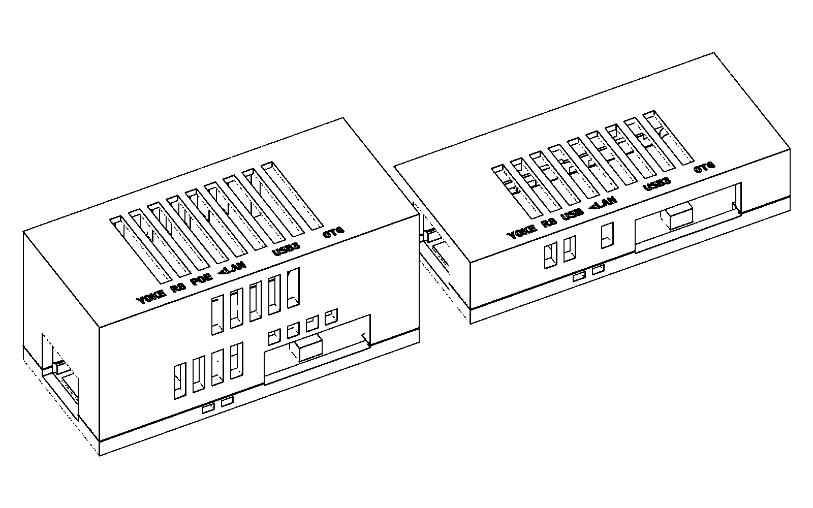
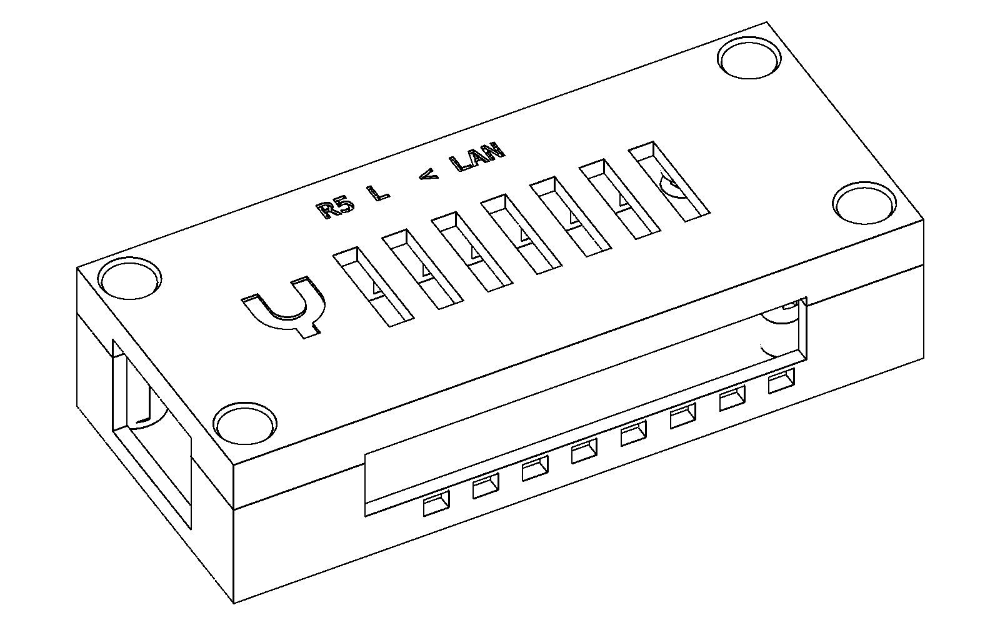

# USB endpoint housing

The current design is **R8: two hardened compact boxes on one base design**.
The device-side box holds a Radxa ZERO 3E with the RA023 PoE HAT (using Radxa's
shipped `14.5 mm` insulated copper pillars). The computer-side box holds a bare
ZERO 3E powered from the host computer's USB-C OTG port (the RK3566 USB 3.0
port is silicon host-only, and combining PoE with USB-C VBUS backfeeds
`+5V_INPUT`). R7 was superseded on 2026-11-25 after a pre-print mechanical,
electrical-safety, and printability audit exposed three blocking defects.

## R8 hardened compact first articles

[R8 source and design decisions](../../hardware/usb-housing/r8/README.md) ·
[Assembly guide](../../hardware/usb-housing/r8/assembly.pdf) ·
[Digital validation](../../hardware/usb-housing/r8/validation.json) ·
[Mechanical references](../../hardware/usb-housing/poe-reference.json)

| Box | Outer size (mm) | Compared with R7 / R6 |
|---|---|---|
| PoE (device side) | **84.55 × 38.00 × 40.20** | 1.5 mm shorter than R7 (matches 14.5 mm pillars + 3.0 mm roof clearance); 31% less volume than R6 |
| Bare (computer side) | **84.55 × 38.00 × 19.20** | Exact 73 printed lid layers; adds solid roof shroud over 40-pin GPIO and float-proof retention ribs |

One print plate carries both boxes: two identical bases, the PoE lid, and the
bare lid. Lacuna's estimate is **54.54 g** of PLA and about **4 h 37 min** plus
preparation (`178` layers, supports disabled). Each box closes with four
recessed **M3 × 8** socket-head screws into **RX-M3×5.7** heat-set inserts.
Physical fit, cable seating, service cycles, and powered cooling remain **NOT
RUN** until observed on the printed hardware.

The plate passed a second independent cold review (the first caught hollow lid
insert bosses under the frozen 2-wall/15% infill profile and bare-lid rib float
clearances) and Lacuna `tools.print approve` (`GEOMETRY=PASS`, `0` collisions,
`0` gaps under `0.1 mm`). It was submitted once at `2026-11-25 21:13:02 UTC`
and verified `PRINTING` with exact filename `yoke-usb-housing-r8.gcode` at
`21:13:23 UTC`. See the [print record](../../hardware/usb-housing/r8/print.json).
Do not resend it; reconcile the existing job.

**Closure and solid insert bosses.** Lid walls lower vertically over three
`1.2 mm` beveled inner lip bars (`0.4 mm` clearance per side, `1.0 mm`
engagement, `0.5 mm` lead-in, strictly clear of the USB-C bay and all four live
corner mounts). Eliminating R7's lid seat recess keeps continuous `2.70 mm`
exterior corner walls straight down to `z = 4.6`, where flat Ø`8.10 mm` lid
post faces bear directly on solid Ø`8.50 mm` base post rings (`>= 34.94 mm²`
per post), leaving a clean `0.3 mm` shadow gap above `seam = 4.3`.

Each screw enters a chamfered Ø`6.3 mm` bottom well (`0.4 mm` head recess,
`>= 1.10 mm` 360° inboard wall and `>= 1.85 mm` exterior wall), bears on two
`25 mm/s` bridged shelves at `z = 3.4` (`3.4 × 3.4 mm` square bridge layer
matching `clearance_d`) fused through four solid layers to `z = 4.6`, and
engages the full `5.7 mm` RX-M3×5.7 insert (`z = 4.8..10.5`, `0.7 mm` blind
pilot reserve). Three `60° × 0.12 mm` open-top vertical perimeter-forcing arc
seams at `r = 3.92..4.04 mm` (`z = 4.6..12.6`) force OrcaSlicer's frozen
`wall_loops = 2 / 15%` profile to print four continuous concentric solid wall
rings around all eight inserts (`0` sparse-infill layers inside `r = 2.30..3.90
mm`, verified directly in G-code) while preserving `0.96 mm` unbroken 2-loop
outer corner skin and solid radial ties. Neither PCB lies in the clamp stack.

**Retention and electrical shrouding.** The SBC underside rests on six
component-free edge pads (`z = 5.8`). Lid ribs stop `0.4 mm` above
component-free top edges without clamping PCBs or loading the conductive PoE
pillars. On the bare lid, front ribs (`x = 20.0..22.4` and `30.0..32.4`) clear
micro-HDMI by `4.30 mm` and USB3 by `4.67 mm`, while rear ribs
(`y = 29.50..30.60`) clear worst-case `5.08 mm` 2×20 GPIO headers across the
entire `±0.27 mm` RJ45-cradle board float. All roof and side vents stay within
`x = 10..53` (`>= 6.4 mm` solid shroud over all four live `48–57 V` corner
mounts), bare roof slots end at `y = 22.0` to shroud the exposed 40-pin GPIO
`+5V`/GND header, and full-height Ø`8.0 mm` keepouts clear all three printed
parts.

**Openings and labeling.**

- **Ethernet:** end window (`y = 6.03..23.73`, `z = 2.35..15.80`) adds
  `+1.55 mm` top-latch/boot clearance above sturdy `1.2 mm` side cradle walls.
- **USB-C:** expanded side opening (`x = 33.8..61.8`, `z = 3.7..14.2`) clears
  `15.0 × 10.0 mm` overmolded plugs on both receptacles. Roof recessed labels
  mark `<LAN`, `USB3` (inner host-only port), and `OTG` (outer gadget/power
  port); base underside marks `YOKE R8 BASE  LAN >`.
- **HDMI:** covered. **Opposite end:** solid. **microSD:** internal service
  (lid off, lift board).
- **Ventilation:** desk-open low inlets below `seam = 4.3`, side rows, and 9
  roof slots (`1,238.1 mm²` PoE / `742.2 mm²` bare geometric open area; not
  measured airflow).

## Reference limits and acceptance

Follow [Radxa's RA023 assembly instructions](https://docs.radxa.com/en/zero/zero3/accessories/3e-poe-hat)
for the four `M2.5 × 14.5 mm` insulated copper pillars and eight `CM2.5 × 4`
metal screws. They carry live IEEE 802.3af/at Mode A PoE voltage; keep them
installed, tightened, and insulated, and never connect both PoE and USB-C power
simultaneously. The bare box leaves its corner mounting holes empty and
shrouded because they remain wired to the RJ45 centre taps.

First-article physical acceptance starts unpowered (stock check, free empty-lid
fit, `14.2–14.8 mm` measured HAT gap else adjust `hat_gap` and reprint only the
PoE lid, `0.15–0.45 mm` seam shadow gap, recessed heads, full USB3/OTG and
top-latch RJ45 seating, ten service cycles), followed by sustained-load open vs
closed powered cooling (`>= 30 min` plateau, provisional `45 °C` PLA surface
stop limit). Digital checks do not establish printed fit, strength, or thermal
margin.

## Superseded R7 compact first articles

[R7 source and design decisions](../../hardware/usb-housing/r7/README.md) ·
[Assembly guide](../../hardware/usb-housing/r7/assembly.pdf) ·
[Print record](../../hardware/usb-housing/r7/print.json)

**Superseded 2026-11-25 (do not repeat; blocked in Lacuna `retired-jobs.d/yoke-usb-housing-r7.json`).**
R7 (`81.4 × 36.25 × 41.7 mm` PoE / `18.5 mm` bare) was printed on 2026-11-04
before boards arrived. The 2026-11-25 audit found three blockers: `18.0 mm`
source CAD gap mismatched Radxa's shipped `14.5 mm` copper pillars, `r = 4.3 mm`
lid corner seat recesses cut through exterior corner walls, and roof/side vents
exposed the live `48–57 V` corner mounts and bare 40-pin GPIO (plus hollow lid
insert bosses under the frozen 2-wall/15% profile and tight USB-C/RJ45 windows).
R8 fixes all of these.

## Superseded R6 PoE first article

[R6 source and assembly](../../hardware/usb-housing/r6/README.md) ·
[Assembly guide](../../hardware/usb-housing/r6/assembly.pdf) ·
[Print record](../../hardware/usb-housing/r6/print.json)

**Superseded 2026-11-04: the owner judged the printed R6 too large.** It
measured 89 × 45.5 × 46 mm. Do not print R6 again.

## Historical R5 bare-board article

[R5 design and assembly](../../hardware/usb-housing/r5/README.md) ·
[Assembly guide](../../hardware/usb-housing/r5/assembly.pdf)

R5 (`84 × 35.9 × 20 mm`) was retired on 2026-11-03 because the device-side box
needs the PoE HAT.

## Rejected revisions

**Do not print R1, R3, R4, R5, R6 or R7 again.** Their jobs are blocked in
Lacuna `tools/print/retired-jobs.d/`.

| Revision | Physical / audit result | Record |
|---|---|---|
| R7 | Printed 2026-11-04; superseded 2026-11-25 after audit exposed 18 vs 14.5 mm HAT gap, corner wall breakthroughs, and unshrouded live mounts/GPIO | [Print record](../../hardware/usb-housing/r7/print.json), [R8 fixes](../../hardware/usb-housing/r8/README.md#what-r8-fixes-over-r7) |
| R6 | Printed; owner judged it too large (2026-11-04) | [Print record](../../hardware/usb-housing/r6/print.json), [R7 comparison](../../hardware/usb-housing/r7/README.md#where-the-space-went) |
| R5 | Physical fit not observed; design omits required PoE HAT | [Print record](../../hardware/usb-housing/r5/print.json), [PoE reference](../../hardware/usb-housing/poe-reference.json) |
| R4 | Owner reports test pieces do not line up or slot together | [Owner result](../../hardware/usb-housing/r4/owner-result.json), [historical design](../../hardware/usb-housing/r4/README.md) |
| R3 | Owner reports assembly failure | [Owner result](../../hardware/usb-housing/r3/owner-result.json) |
| R2 | Branding revision; not printed | [Historical CAD](../../hardware/usb-housing/r2/housing.scad) |
| R1 | Printed; owner rejected | [Original dispatch record](../../hardware/usb-housing/print.json) |

The [USB hardware design](USB-ENDPOINT.md) describes the two-box product.
