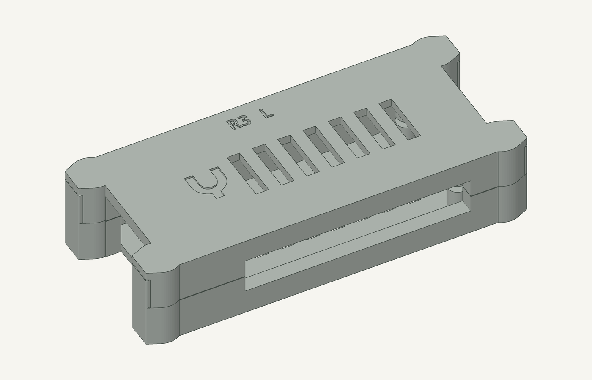
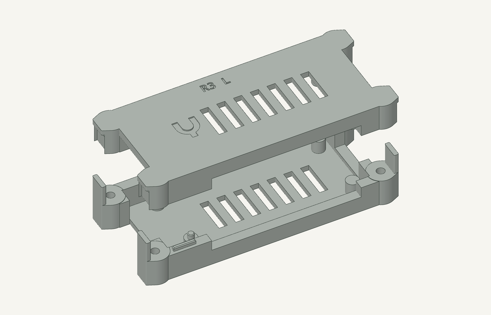
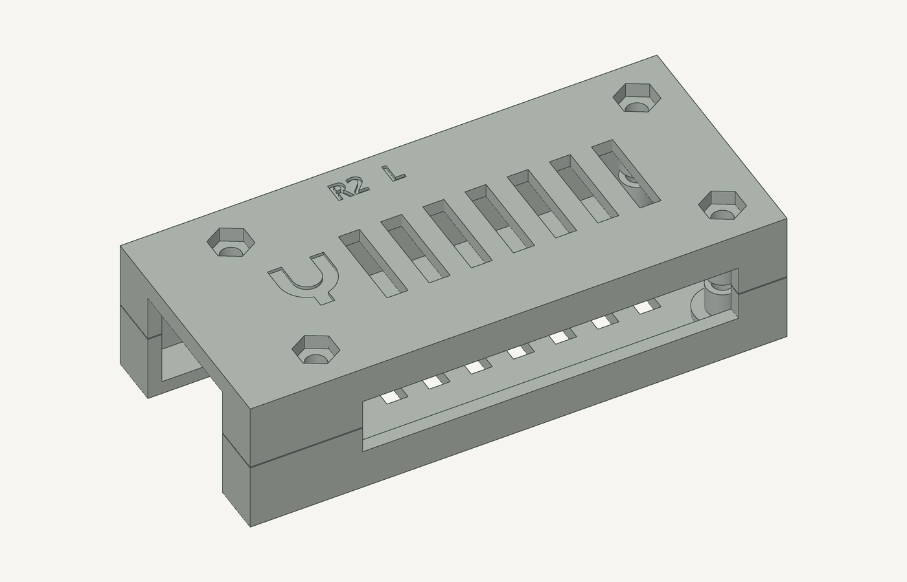
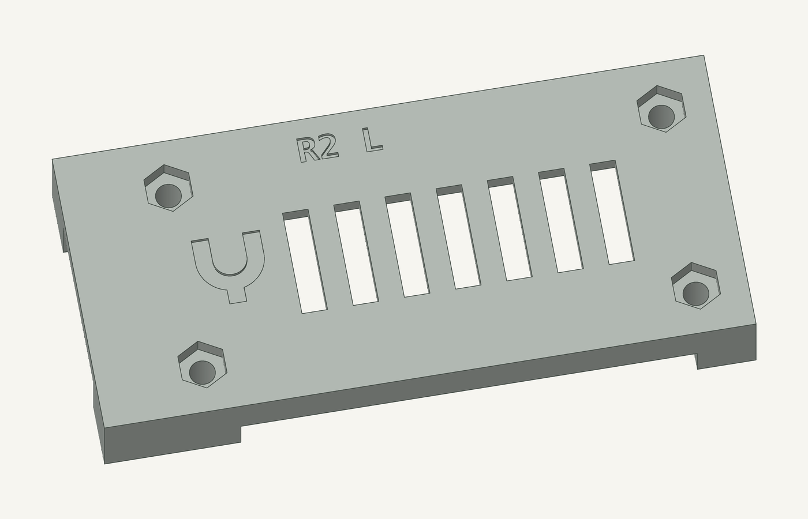

# USB endpoint housing

**R1 and R3 were printed and rejected by the owner. Do not print either
revision again.** [R3 owner result](../../hardware/usb-housing/r3/owner-result.json).

The replacement is being designed as a compact rectangular shell with no
projecting ears, a slot joint, recessed M3 socket-head screws and heat-set
inserts from the same kit as Lacuna. Insert dimensions are still being
confirmed. The R3 material below is historical, not the current build
recommendation. The board is the [selected USB hardware](USB-ENDPOINT.md).

The USB endpoint case is a screw-closed two-piece prototype for the
**Radxa ZERO 3E V1.2**. **R3 was the last printed mechanical revision:** locating
tongues register the halves, screw heads sit in recesses, and metal nuts
supply the threads. R1 and R2 retain their original geometry for reference.

R1 was the first-article print revision. R2 added the canonical brand without
changing its mechanics. **R2 has not been printed. The first R3 main-plate
job was submitted and verified printing**; see its
[dispatch record](../../hardware/usb-housing/r3/print.json). The R3 files do
not replace the original R1 G-code or its print record. The owner reports that assembly failed. Specific fit measurements have
not been recorded; cable access, retention and thermal tests remain **NOT RUN**.

## R3: locating joint and recessed fasteners

Three chamfered tongues enter matching lid pockets before tightening. They
register the halves without acting as the vertical clamp stops. Two locating
pegs register the board; one is relieved to accommodate hole-spacing error.
The board cavity retains the original nominal edge clearances.

Four end lugs move the case screws away from the PCB mounting holes and
connector cutouts. Their mating faces carry screw preload, leaving the board
on its mounting-pad supports. The body is **79.6 × 38 × 20 mm**; the end-lug
envelope is **90.4 × 39.6 × 20 mm**. This is larger than R1 to provide material
around the head recesses and metal-thread seats.

Use four **M2.5 × 16 mm Phillips pan-head screws** and four **M2.5 hex nuts**.
The modeled screw envelope is 5 mm maximum head diameter, 2.12 mm maximum
head height and 16 ± 0.35 mm under-head length, based on the
[manufacturer's specification](https://www.accu.co.uk/phillips-pan-head-screws/174946-SIP-M2-5-16-A4-BL).
R1's 20 mm screws are not interchangeable with these fasteners.



The nut pockets load from the sides. Integral keeper fingers close their
exits when the halves are seated, so the nuts are captured in the closed
assembly. Opening the case reopens those exits; follow the service sequence
over a tray. Plastic holes are clearance holes, **not printed threads**.



Use the [R3 assembly guide](../../hardware/usb-housing/r3/README.md) and its
[assembly PDF](../../hardware/usb-housing/r3/assembly.pdf) for the actual
hardware inventory, bore cleanup, locating-joint fit, screw/nut section and
unpowered first-article checks. Manufacturing membranes in both halves
require clearing **eight bores** with a 3 mm bit used by hand before fitting
the hardware. A small fit coupon is included so these interfaces can be
checked before committing to a complete case print.

Download the [R3 fit coupon](../../hardware/usb-housing/r3/yoke-usb-housing-r3-coupon.stl)
for the actual corner joint, head seat, nut trap and keeper interfaces.
The coupon also needs its own reviewed print preparation before use.

The first R3 main-plate job passed exact-slice and assembly/manufacturing
review before dispatch. It remains a prototype pending physical tests.
Subsequent prints need their own reviewed exact job and a clear bed.



## R2 branding

The [Yoke identity](BRANDING.md) appears as one small monochrome recess on
the lid, beside the vents. The CAD imports the canonical SVG directly.
The mark is 8 × 8.667 mm, recessed 0.45 mm, with 2 mm broad elements and
1.55 mm of roof beneath it. Its centre is (9, 15) mm in the original board
coordinate frame; the nearest vent starts 3 mm away.



R2 restores the old exterior text pockets and engraves `R2 B` / `R2 L` part
IDs. Its native model imports the R1 mechanical modules. Exact mesh
comparison confines every added or removed volume to the shallow exterior
ID and mark regions. Screw bores, nut bearing seats, support posts, the
0.15 mm seam gap, cable openings and vents are unchanged. Each mesh is
watertight; the two-part plate rebuilds byte for byte. These are nominal
digital checks, not a physical qualification.

## Download and rebuild

| Revision | Native CAD | Two-part plate | Instructions and evidence |
| --- | --- | --- | --- |
| R3 — rejected; do not print | [OpenSCAD](../../hardware/usb-housing/r3/housing.scad) | [R3 STL](../../hardware/usb-housing/r3/yoke-usb-housing-r3.stl) | [Assembly PDF](../../hardware/usb-housing/r3/assembly.pdf), [guide](../../hardware/usb-housing/r3/README.md), [print record](../../hardware/usb-housing/r3/print.json) |
| R1 — rejected first article | [OpenSCAD](../../hardware/usb-housing/housing.scad) | [R1 STL](../../hardware/usb-housing/yoke-usb-housing-r1.stl) | [Assembly PDF](../../hardware/usb-housing/assembly.pdf), [print record](../../hardware/usb-housing/print.json) |
| R2 — NOT PRINTED | [OpenSCAD](../../hardware/usb-housing/r2/housing.scad) | [R2 STL](../../hardware/usb-housing/r2/yoke-usb-housing-r2.stl) | [Rebuild script](../../hardware/usb-housing/r2/build.py), [mesh validation](../../hardware/usb-housing/r2/validation.json) |

The R2 [base](../../hardware/usb-housing/r2/base.stl) and
[finished lid](../../hardware/usb-housing/r2/lid.stl) describe the assembled
parts. Its [manufactured lid](../../hardware/usb-housing/r2/lid-printed.stl)
includes the four 0.20 mm sacrificial bore membranes. Rebuild from the
repository root using Manifold-enabled OpenSCAD:

```sh
python3 hardware/usb-housing/r2/build.py
```

The script pins the R1 geometry and canonical brand asset hashes. Changing
either requires review. The R2 plate and component declarations are design
artifacts; they carry no print release. A future print needs a fresh slice,
exact-artifact manufacturing and assembly review, release and a clear bed.

## R1/R2 assembly reference

Supply four **M2.5 × 20 mm pan-head machine screws**, four **M2.5 hex nuts**,
a matching screwdriver and a **3 mm drill bit used by hand**. Follow the
[assembly PDF](../../hardware/usb-housing/assembly.pdf); R2 uses its same
sequence with `R2 B` / `R2 L` identification.

1. With the lid alone on scrap wood, hand-clear its four thin bore membranes.
   Remove swarf; require clear 3.0–3.2 mm lid bores and intact flat nut seats.
2. Keep the board unpowered. Lower it onto the four base posts, Ethernet
   toward the open short end, then lower the matching lid without force.
3. Seat the nuts from above. Hold the case above a table edge and insert
   the 20 mm screws upward from below.
4. Lightly snug alternating corners. Preserve the intentional 0.15 mm seam
   gap. Stop for board bow, cracking, whitening, a spinning nut or rising
   torque before seating. No tightening torque has been qualified.

The thin post ligaments beside Ethernet retain the R1 light-hand-snug and
5 N prototype trial scope. Test actual Ethernet latch access and both USB-C
cables unpowered, then retention, then a 30-minute intended-load thermal
run with clear vents. Stop at 75 °C or a lower applicable manufacturer
limit. Record the actual board, filament, seam, cable and temperature results
before deployment.

The model targets the bare board. USB-C cable overmoulds are assumed to be no
larger than 12 × 7 mm. A PoE HAT, added heatsink, bracket or ingress protection
needs a separate envelope and design check. The vendor board mesh is
nonmanifold; the existing sampled assembly check and conservative component
clearance inspection do not establish continuous collision-free motion or
measured fit.
