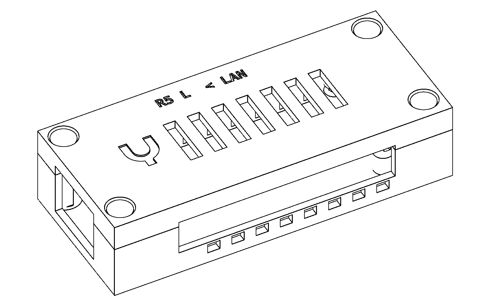

# USB endpoint housing

The required case holds one **Radxa ZERO 3E plus its PoE HAT**, including
conductive mounting hardware, fan, wiring and any fitted heatsinks. It must
be a compact rectangle whose halves lower freely together and fasten with
recessed M3 screws and RX-M3×5.7 heat-set inserts from the Lacuna stock.

**The PoE housing is unfinished. R5 omitted the HAT and is retired.** Its
bare-board geometry and digital review are not evidence of PoE compatibility.

## Complete-stack dimensions needed

The [mechanical reference record](../../hardware/usb-housing/poe-reference.json)
records the official files inspected on 2026-11-03. Radxa's
[combined assembly CAD](https://dl.radxa.com/zero3/docs/hw/3e/rs109_ra023.stp.zip)
places the facing PCB surfaces 18 mm apart. The
[current product specification](https://radxa.com/products/accessories/zero-3e-poe-hat/)
lists M2.5 × 14.5 insulated copper pillars. The current downloadable HAT
model is byte-identical to the older model; its filename alone does not
resolve that difference.

The supplied CAD is about 36.96 mm tall, but omits the conductive pillars,
board screws, fan fasteners, fan leads and photographed heatsinks. That
height is a reference envelope, not a verified complete assembly. The actual
HAT revision, facing-PCB gap, complete outer envelope and cooling configuration
must be established before release. Supports around screw heads also need
head dimensions; retaining verified lower-board edges could instead leave
the mounting hardware inside measured keepouts. No replacement has been
sliced or dispatched.

Radxa's [assembly instructions](https://docs.radxa.com/en/zero/zero3/accessories/3e-poe-hat)
require the metal screws and copper pillars for PoE. Printed supports must
preserve these electrical connections and insulating sleeves. The enclosure's
M3 screws remain separate from the board/HAT mounting hardware.

Ventilation must provide clear paths from side inlets to the underside HAT
fan and from both boards to upper outlets. Inlets must remain open on a flat
desk; retention features and fan wires must clear them. Free area, component
clearances and exact toolpaths require design review. Powered temperature,
fan operation and sustained-load cooling remain physical tests.

## Historical R5 bare-board article

[R5 design and assembly](../../hardware/usb-housing/r5/README.md) ·
[Assembly guide](../../hardware/usb-housing/r5/assembly.pdf)

### How R5 closes

A chamfered lip inside the lid locates it in the base. Lower the lid vertically
until the mating faces seat, then fit the four screws. To open it, remove the
screws and lift straight up. The screws hold the case closed; they must never
be used to force an interfering lid or board into place.

The nominal envelope is **84 × 35.9 × 20 mm**. Four internal fastener bays
keep the screws clear of the PCB. There are no external ears or towers.
The added length compared with R4 accommodates the two rear fasteners and
removes the need for small retaining hooks. The case is for the bare board
and cannot accommodate the required PoE HAT.

Low side inlets remain open on a desk, and top vents let warm air escape.
Their geometry can be checked before printing; cooling performance requires
a test with the actual powered board and workload.

### Historical assembly checks

The [first R5 print](../../hardware/usb-housing/r5/print.json) contains the
**complete base and lid**. It was submitted and verified printing: estimated
21.16 g PLA and 1 hour 36 minutes. Check their fit before
installing metal parts or the board. Match the inserts to the specified
RX-M3×5.7 part, set them in the empty base, and let it cool before assembly.
The guide gives screw length, recess and engagement checks, board orientation,
cable access and the reverse opening sequence.

We use Lacuna's mesh, support, assembly and toolpath checks on the actual
parts, with an independent review of the assembly guide. These checks do not
prove the fit or cooling of printed plastic. R5 remains a first physical
article until its assembly and thermal observations are recorded.

## Rejected revisions

**Do not print R1, R3, R4 or R5 again.** Their earlier digital reviews do not
establish successful physical assembly. The printer guard blocks the known
rejected jobs.

| Revision | Physical result | Record |
|---|---|---|
| R5 | Physical fit not observed; design omits required PoE HAT | [Print record](../../hardware/usb-housing/r5/print.json), [PoE reference](../../hardware/usb-housing/poe-reference.json) |
| R4 | Owner reports test pieces do not line up or slot together | [Owner result](../../hardware/usb-housing/r4/owner-result.json), [historical design](../../hardware/usb-housing/r4/README.md) |
| R3 | Owner reports assembly failure | [Owner result](../../hardware/usb-housing/r3/owner-result.json) |
| R2 | Branding revision; not printed | [Historical CAD](../../hardware/usb-housing/r2/housing.scad) |
| R1 | Printed; owner rejected | [Original dispatch record](../../hardware/usb-housing/print.json) |

R4 depended on a sideways slide and small retaining hooks. Its separate test
pieces also had unequal crop boundaries, making the instruction to align their
outside faces ambiguous. Those are design and instruction weaknesses; the
exact dimensional cause of the failed printed fit has not been measured.
R5 replaces that joint and prints the complete halves together.

The [USB hardware design](USB-ENDPOINT.md) describes the two-box product.
