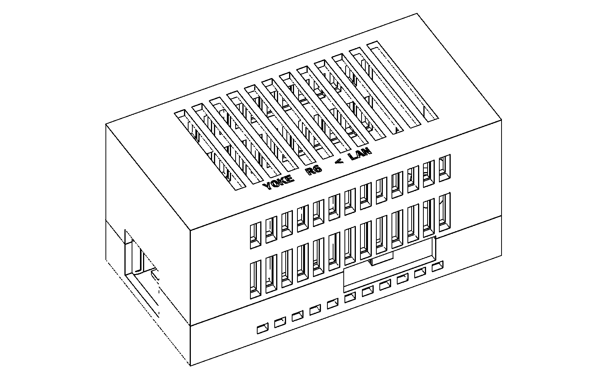

# USB endpoint housing

The current design is **R6: Radxa ZERO 3E plus PoE HAT**, with two nesting
shell halves and two internal PCB clips. It preserves the supplied conductive
mounting hardware and insulating sleeves. R5 omitted the HAT and is retired.

## R6 PoE first article

[R6 source and assembly](../../hardware/usb-housing/r6/README.md) ·
[Assembly guide](../../hardware/usb-housing/r6/assembly.pdf) ·
[Print record](../../hardware/usb-housing/r6/print.json) ·
[Mechanical references](../../hardware/usb-housing/poe-reference.json)

R6 passed independent cold review and was submitted once on 2026-11-03; the
printer verified the exact job as PRINTING. The four-part plate estimates
46.9 g PLA and about four hours. Physical acceptance remains NOT RUN.

The enclosure is **89 × 45.5 × 46 mm**. Ethernet exits one end. A single
**26.2 × 8.2 mm** opening along the lower side serves both USB-C ports.
The opposite end is closed; HDMI is covered. Fit microSD before seating the
board, and remove the electronics for card service.

Four pads support clear regions of the lower PCB. Two removable clips limit
lift with 0.4 mm nominal clearance. No printed peg occupies a conductive
mounting hole. The HAT fits after the clips are fastened, so neither its
height nor its upper components determine enclosure retention.

Four recessed **M3 × 16** socket-head screws enter from underneath and engage
RX-M3×5.7 heat-set inserts in the lid. Two **M3 × 8** screws and two additional
inserts hold the clips. Install all six inserts in empty printed parts and
let them cool before electronics are installed. The lid lowers vertically
with 0.5 mm clearance per side; screws must never force the halves together.

Both long sides have vent rows between and above the PCBs; roof slots provide
upper outlets. Separate low side inlets remain open on a flat desk. The
vent cuts pass through both the outer wall and inner locating skirt. Nominal
side openings total 936 mm² between boards and 624 mm² above them; roof
openings total 1,188 mm². These areas describe geometry, not measured cooling.
Space is retained for the underside fan in the published model, without
assuming the purchased HAT includes that fan.

## Reference limits and acceptance

The ordered board is [ZERO 3E 2GB with GPIO, B0CZD1C54N](https://www.amazon.com/dp/B0CZD1C54N),
and the HAT is [Radxa B0D1KF1L7G](https://www.amazon.com/dp/B0D1KF1L7G).
The owner says neither has arrived and expects them Thursday. On 2026-11-03
the owner explicitly requested a computed housing now. R6 therefore proceeds
as a nominal first article; complete physical fit and powered cooling are
**NOT RUN**.

The [official assembly CAD](https://dl.radxa.com/zero3/docs/hw/3e/rs109_ra023.stp.zip)
places facing PCBs 18 mm apart; Radxa's
[product specification](https://radxa.com/products/accessories/zero-3e-poe-hat/)
lists 14.5 mm pillars. Catalog photos show a fanless X1.0 HAT, while the
published assembly includes a fan. These discrepancies remain recorded.
The source model is kept unchanged; R6 does not claim that its spacing or
complete height is a measured upper bound for the delivered parts.

At the reference placement, the tallest modeled component has 3.5 mm roof
clearance. Diameter-8 corner reservations allow mounting hardware; card and
cable reservations account for parts absent from the source. These are
explicit design allowances. Additional heatsinks or wiring must fit inside
the available space and clear the vents. The lower-PCB retention avoids the
need to clamp against unknown HAT heights or screw heads.

Follow [Radxa's assembly instructions](https://docs.radxa.com/en/zero/zero3/accessories/3e-poe-hat)
for the electrically required metal screws and insulated copper pillars.
Enclosure screws are separate. On arrival, inspect the unpowered complete
assembly first, then check cable access and ten opening/closing cycles.
Powered testing compares sustained-load temperatures with the lid open and
closed; throttling, resets, loose electrical mounting or softened plastic
are stop conditions. Digital clearance checks cannot pass these physical tests.

## Historical R5 bare-board article

[R5 design and assembly](../../hardware/usb-housing/r5/README.md) ·
[Assembly guide](../../hardware/usb-housing/r5/assembly.pdf)

### How R5 closes

A chamfered lip inside the lid locates it in the base. Lower the lid vertically
until the mating faces seat, then fit the four screws. To open it, remove the
screws and lift straight up. The screws hold the case closed; they must never
be used to force an interfering lid or board into place.

The nominal envelope is **84 × 35.9 × 20 mm**. Four internal fastener bays
keep the screws clear of the PCB. There are no external ears or towers.
The added length compared with R4 accommodates the two rear fasteners and
removes the need for small retaining hooks. The case is for the bare board
and cannot accommodate the required PoE HAT.

Low side inlets remain open on a desk, and top vents let warm air escape.
Their geometry can be checked before printing; cooling performance requires
a test with the actual powered board and workload.

### Historical assembly checks

The [first R5 print](../../hardware/usb-housing/r5/print.json) contains the
**complete base and lid**. It was submitted and verified printing: estimated
21.16 g PLA and 1 hour 36 minutes. Check their fit before
installing metal parts or the board. Match the inserts to the specified
RX-M3×5.7 part, set them in the empty base, and let it cool before assembly.
The guide gives screw length, recess and engagement checks, board orientation,
cable access and the reverse opening sequence.

We use Lacuna's mesh, support, assembly and toolpath checks on the actual
parts, with an independent review of the assembly guide. These checks do not
prove the fit or cooling of printed plastic. R5 remains a first physical
article until its assembly and thermal observations are recorded.

## Rejected revisions

**Do not print R1, R3, R4 or R5 again.** Their earlier digital reviews do not
establish successful physical assembly. The printer guard blocks the known
rejected jobs.

| Revision | Physical result | Record |
|---|---|---|
| R5 | Physical fit not observed; design omits required PoE HAT | [Print record](../../hardware/usb-housing/r5/print.json), [PoE reference](../../hardware/usb-housing/poe-reference.json) |
| R4 | Owner reports test pieces do not line up or slot together | [Owner result](../../hardware/usb-housing/r4/owner-result.json), [historical design](../../hardware/usb-housing/r4/README.md) |
| R3 | Owner reports assembly failure | [Owner result](../../hardware/usb-housing/r3/owner-result.json) |
| R2 | Branding revision; not printed | [Historical CAD](../../hardware/usb-housing/r2/housing.scad) |
| R1 | Printed; owner rejected | [Original dispatch record](../../hardware/usb-housing/print.json) |

R4 depended on a sideways slide and small retaining hooks. Its separate test
pieces also had unequal crop boundaries, making the instruction to align their
outside faces ambiguous. Those are design and instruction weaknesses; the
exact dimensional cause of the failed printed fit has not been measured.
R5 replaces that joint and prints the complete halves together.

The [USB hardware design](USB-ENDPOINT.md) describes the two-box product.
