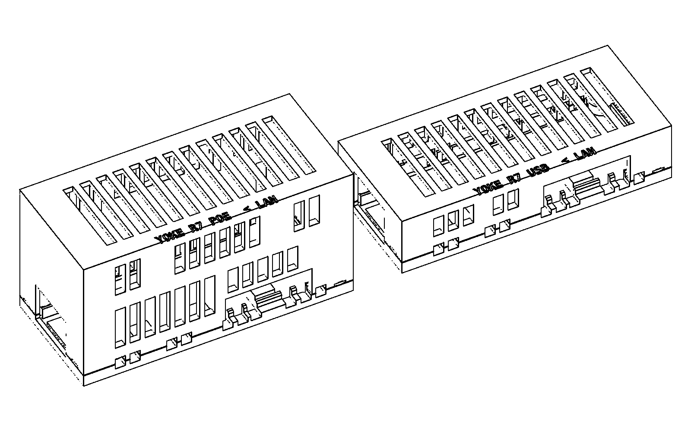

# USB endpoint housing

The current design is **R7: two compact boxes on one base design**. The
device-side box holds a Radxa ZERO 3E with the RA023 PoE HAT. The
computer-side box holds a bare ZERO 3E powered from the computer's USB-C
port. R6 was superseded on 2026-11-04 because the owner judged the printed
R6 too large. R5 omitted the HAT and is retired.

## R7 compact first articles

[R7 source and design decisions](../../hardware/usb-housing/r7/README.md) ·
[Assembly guide](../../hardware/usb-housing/r7/assembly.pdf) ·
[Digital validation](../../hardware/usb-housing/r7/validation.json) ·
[Mechanical references](../../hardware/usb-housing/poe-reference.json)

| Box | Outer size (mm) | Compared with R6 |
|---|---|---|
| PoE (device side) | 81.4 × 36.25 × 41.7 | 34% less volume |
| Bare (computer side) | 81.4 × 36.25 × 18.5 | No R6 counterpart; R6 had only the PoE box |

One print plate carries both boxes: two identical bases, the PoE lid and the
bare lid. Lacuna's estimate is 44.3 g of PLA and about 3 h 51 min. Each box
closes with four recessed **M3 × 8** socket-head screws in **RX-M3×5.7**
inserts. Physical fit and powered cooling are **NOT RUN**. Electronics are
expected 2026-11-05.

The plate passed a second independent cold review (the first failed the
case-screw joint) and Lacuna approval. It was submitted once at
2026-11-04 20:29:59 UTC and verified PRINTING with the exact filename at
20:30:08 UTC. See the [print record](../../hardware/usb-housing/r7/print.json).
Do not resend it; reconcile the existing job.

**Closure.** The lid lowers vertically over a 1.2 mm base lip, which sits
below the PCB. Clearance is 0.4 mm per side and engagement is 1.5 mm. Each
base post stays a solid 7.8 mm ring up to a seat at z = 4.6. The lid post
bears on that ring over about 29 mm², and the four seats are the only hard
stops. They leave a 0.3 mm shadow gap at the seam, which screws must never
close.

Heads sit 0.4 mm inside bottom wells. Each head bears on a bridged shelf,
which four solid layers fuse into the post ring. The clamp runs from head to
shelf to post ring, then to the seat and the lid insert, without loading
either PCB.

**Screws.** Two screws sit beside the RJ45 in space R6 did not use. The two
closed-end posts merge into the end and side walls. An insert boss must lie
outside the path along which the board stack is lowered, so these posts
cannot move inside x ≈ 69.2. The [R7 README](../../hardware/usb-housing/r7/README.md#design-decisions)
explains the constraint and the rejected alternatives.

**Retention.** The SBC underside rests on six component-free edge pads. Lid
ribs stop 0.4 mm above component-free top edges: on the HAT in the PoE box
and on the SBC in the bare box. The ribs limit lift without clamping the
boards. The complete Radxa stack is assembled outside the case and lowered as
one unit. The case needs no clips.

**Openings.**

- **Ethernet:** one end. The other end is closed.
- **USB-C:** a single long side opening serves both receptacles. Their faces
  are 2.15 mm inside the outer wall, so ordinary overmolded plugs seat fully.
- **HDMI:** covered.
- **microSD:** changed with the lid off and the board lifted out. The design
  allows 2.5–3 mm of card projection at the closed end.

**Ventilation.** Low side inlets stay open on a desk. The boxes also have
side rows and roof slots. Geometric open area is 2,270 mm² for PoE and
1,511 mm² for bare. These areas are not cooling measurements.

## Reference limits and acceptance

The ordered board is [ZERO 3E 2GB with GPIO, B0CZD1C54N](https://www.amazon.com/dp/B0CZD1C54N),
and the HAT is [Radxa B0D1KF1L7G](https://www.amazon.com/dp/B0D1KF1L7G).
The [official assembly CAD](https://dl.radxa.com/zero3/docs/hw/3e/rs109_ra023.stp.zip)
places facing PCBs 18 mm apart. Radxa's
[product specification](https://radxa.com/products/accessories/zero-3e-poe-hat/)
lists 14.5 mm pillars. R7 follows the 18 mm CAD with 1.0 mm roof clearance.
Only the PoE lid depends on that gap. If the delivered stack differs, change
`hat_gap` and reprint that lid; the base stays the same.

Catalog photos show a fanless X1.0 HAT, while the published assembly includes
a fan. The fan fits between the boards, so it needs no extra envelope.

Follow [Radxa's assembly instructions](https://docs.radxa.com/en/zero/zero3/accessories/3e-poe-hat)
for the metal screws and insulated copper pillars. They carry PoE voltage. No
case fastener substitutes for them, and no metal path from them reaches the
outside. The bare box treats its mounting holes the same way. Those holes
remain wired to the RJ45 centre taps, so nothing enters them.

On arrival, the first checks are unpowered:

- empty fit of each lid;
- the complete board fit;
- cable seating;
- ten service cycles.

Powered testing then compares sustained-load temperatures with the lid open
and closed. Throttling, resets and softened plastic are stop conditions, as
is case surface above a provisional 45 °C. Digital clearance checks cannot
pass these physical tests.

## Superseded R6 PoE first article

[R6 source and assembly](../../hardware/usb-housing/r6/README.md) ·
[Assembly guide](../../hardware/usb-housing/r6/assembly.pdf) ·
[Print record](../../hardware/usb-housing/r6/print.json)

**Superseded 2026-11-04: the owner judged the printed R6 too large.** It
measured 89 × 45.5 × 46 mm. Most of the excess came from three places:

- 12.7 mm at the closed end for case-screw and clip bosses;
- a 7.5 mm USB-side gap for a clip boss, which left the USB-C faces 9.5 mm
  inside the wall;
- 3.5 mm of roof headroom.

R6 passed independent cold review and was submitted once on 2026-11-03; the
printer reported the exact job as PRINTING. It used two shell halves, two
screw-retained PCB edge clips and four M3 × 16 case screws. Its physical
acceptance was not run. Do not print R6 again.

## Historical R5 bare-board article

[R5 design and assembly](../../hardware/usb-housing/r5/README.md) ·
[Assembly guide](../../hardware/usb-housing/r5/assembly.pdf)

R5 was retired on 2026-11-03 because the device-side box needs the PoE HAT.
The R7 bare box now covers the computer-side, bare-board role.

### How R5 closes

A chamfered lip inside the lid locates it in the base. Lower the lid vertically
until the mating faces seat, then fit the four screws. To open it, remove the
screws and lift straight up. The screws hold the case closed; they must never
be used to force an interfering lid or board into place.

The nominal envelope is **84 × 35.9 × 20 mm**. Four internal fastener bays
keep the screws clear of the PCB. There are no external ears or towers.
The added length compared with R4 accommodates the two rear fasteners and
removes the need for small retaining hooks. The case is for the bare board
and cannot accommodate the required PoE HAT.

Low side inlets remain open on a desk, and top vents let warm air escape.
Their geometry can be checked before printing; cooling performance requires
a test with the actual powered board and workload.

### Historical assembly checks

The [first R5 print](../../hardware/usb-housing/r5/print.json) contains the
**complete base and lid**. It was submitted and verified printing: estimated
21.16 g PLA and 1 hour 36 minutes. Check their fit before
installing metal parts or the board. Match the inserts to the specified
RX-M3×5.7 part, set them in the empty base, and let it cool before assembly.
The guide gives screw length, recess and engagement checks, board orientation,
cable access and the reverse opening sequence.

We use Lacuna's mesh, support, assembly and toolpath checks on the actual
parts, with an independent review of the assembly guide. These checks do not
prove the fit or cooling of printed plastic. R5 remains a first physical
article until its assembly and thermal observations are recorded.

## Rejected revisions

**Do not print R1, R3, R4, R5 or R6 again.** Their earlier digital reviews do not
establish successful physical assembly. The printer guard blocks the R1–R6
jobs (Lacuna `tools/print/retired-jobs.d/`).

| Revision | Physical result | Record |
|---|---|---|
| R6 | Printed; owner judged it too large (2026-11-04) | [Print record](../../hardware/usb-housing/r6/print.json), [R7 comparison](../../hardware/usb-housing/r7/README.md#where-the-space-went) |
| R5 | Physical fit not observed; design omits required PoE HAT | [Print record](../../hardware/usb-housing/r5/print.json), [PoE reference](../../hardware/usb-housing/poe-reference.json) |
| R4 | Owner reports test pieces do not line up or slot together | [Owner result](../../hardware/usb-housing/r4/owner-result.json), [historical design](../../hardware/usb-housing/r4/README.md) |
| R3 | Owner reports assembly failure | [Owner result](../../hardware/usb-housing/r3/owner-result.json) |
| R2 | Branding revision; not printed | [Historical CAD](../../hardware/usb-housing/r2/housing.scad) |
| R1 | Printed; owner rejected | [Original dispatch record](../../hardware/usb-housing/print.json) |

R4 depended on a sideways slide and small retaining hooks. Its separate test
pieces also had unequal crop boundaries, making the instruction to align their
outside faces ambiguous. Those are design and instruction weaknesses; the
exact dimensional cause of the failed printed fit has not been measured.
R5 replaces that joint and prints the complete halves together.

The [USB hardware design](USB-ENDPOINT.md) describes the two-box product.
