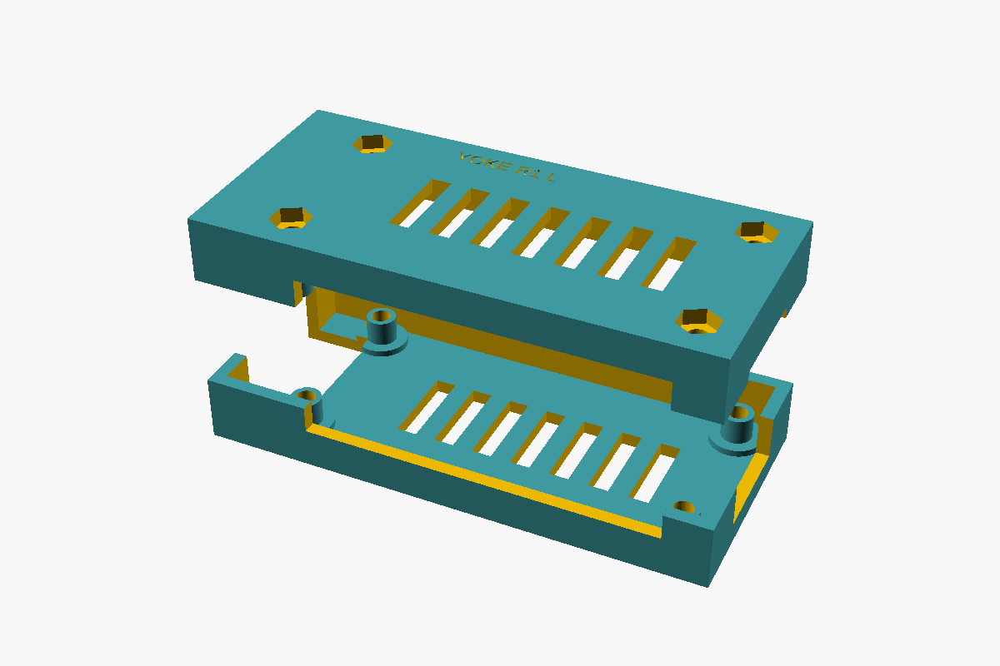

# USB endpoint housing R1

A snug, screw-closed two-piece prototype for the **Radxa ZERO 3E V1.2**.
The four mounting-pad regions carry the clamp load; the housing does not
press on IC packages, GPIO pins or connector shells. The case body is
76.4 × 34.8 × 20 mm, with exposed screw heads below the base.



## Files and rebuilding

- `housing.scad` is the native parametric OpenSCAD model. Select `base`,
  `lid`, `lid-printed`, `plate`, `assembled` or `exploded` with `part`.
- `base.stl` and `lid.stl` describe the finished assembly.
- `lid-printed.stl` includes four **0.20 mm sacrificial bore membranes**.
- `yoke-usb-housing-r1.stl` is the prepared two-part print plate. Its companion
  `.contact.json` binds its two components and the prototype bridge allowance.
- `assembly.pdf` gives the hardware inventory, cleanup, assembly sequence,
  exact-mesh joint section, service sequence and first-article test.
- `print.json` records the exact submitted artifact and printer outcome.

With a Manifold-enabled OpenSCAD installed:

```sh
python3 hardware/usb-housing/build.py
```

`build.py` uses only the Python standard library and OpenSCAD. It renders
both parts and packs their original facets without retessellation. A clean
rebuild reproduced all delivered STL and contact files byte for byte with
OpenSCAD 2026.09.19. Rebuilding or changing the CAD does **not** preserve an
existing print release: slice and review the resulting exact files again.

## Mechanical basis

The [official Radxa downloads](https://docs.radxa.com/en/zero/zero3/download)
identify ZERO 3E V1.2 as the production revision. The model uses the official
V1.2 DXFs and `rs109_pcba.stp`, preserving their PCB coordinate frame.

| Feature | Nominal basis |
| --- | --- |
| PCB | 65 × 30 × 1.6 mm |
| Complete component bounds | x −6.4…65.002, y −1.5…30.006, z −5.26…8.5 mm |
| Mount centres (x, y) | (3.549904, 3.599942), (61.399928, 3.599942), (3.599942, 26.450036), (61.399928, 26.500074) mm |
| Mount finish in STEP | 0.02 mm proud of each PCB face |
| PCB placement | top of laminate z 8.5 mm in the case |
| Lower / upper support faces | z 6.88 / 8.52 mm, matching 1.64 mm pad-to-pad thickness |
| Side clearance | 0.4 mm nominal at straight PCB edges |
| Lowest component / floor clearance | 1.24 mm nominal |
| GPIO tip / roof clearance | 1.0 mm nominal |

The **71.4 mm assembled length includes the Ethernet overhang**. It is not
an alternative PCB length. Archive SHA-256 values:

```text
radxa_zero_3e_v1200_2d.zip
353f331962bc9176eea2b9e8a42cabe24e7d8518c2113672b3075047c563de85
radxa_zero_3e_3d_stp.zip
616fb4e1017a3ca7a1025372ccc018520a7ccd2ba614e2d6454f0782279f6645
```

The Ethernet opening is open along its lower edge for latch access. A shared
seam opening exposes both USB-C ports and micro-HDMI; USB-C cable overmoulds
are assumed to be no larger than 12 mm wide × 7 mm tall. The microSD end has
a service opening. Both halves have 3 × 13 mm ventilation slots.

## Hardware and assembly

Supply four **M2.5 × 20 mm pan-head machine screws** (length measured beneath
the head), four M2.5 hex nuts (nominal 5 mm across flats, 2 mm thick), a
matching screwdriver and a **3 mm drill bit used by hand**. The test also
uses scrap wood, a caliper, a padded mat, a 0–10 N spring gauge or scale,
the actual Ethernet/two USB-C cables, and a powered test host with CPU
temperature readout and a timer. Fasteners and board are not part of the print.

1. Cool and clean both prints. With the lid alone on scrap wood, hand-turn
   the 3 mm bit to remove its four thin membranes and lightly ream the lid
   bores. Remove swarf. Require 3.0–3.2 mm clear bores and four intact flat
   nut seats. Base holes remain nominally 2.9 mm.
2. Keep the board unpowered. Lower it component-side up onto the base posts,
   Ethernet toward the short open end. Lower the matching lid without force.
3. While upright, drop nuts into the exterior lid wells. Hold the case above
   a table edge and insert the screws upward from below.
4. Start all threads, then lightly snug alternating corners until the PCB
   is held. The nominal 0.15 mm seam gap is intentional. Stop for board bow,
   cracking, whitening, a spinning nut, interference or rising torque before
   seating. No tightening torque has been physically qualified.

Use `assembly.pdf` for the joint section and full test procedure. A prototype
print does not establish fit, retention or thermal performance. Test actual
cable engagement and latch release unpowered, then gentle retention, then a
30-minute intended-load thermal run with clear vents. Stop at 75 °C or a
lower applicable manufacturer limit. Record the actual board revision,
filament, seam, nut seating, cable models and results before deployment.

## Scope and verification limits

This revision fits the bare board. A PoE HAT, added heatsink, mounting bracket
and ingress protection require their own measured envelopes and design pass.

The official STEP's raw tessellation is not manifold, so the sampled assembly
checker cannot perform Boolean collision tests against that board mesh.
The packet retains the official STEP and actual mesh for visual review. A
separate conservative triangle-bound check found no component surfaces in any
of the eight upper/lower post regions outside the mounting-pad finish.
The 2026-11-02 independent review accepted the near-Ethernet post ligaments
(about 0.64 mm in the base and 0.59 mm in the lid after the connector cutout)
for light hand snugging and the stated 5 N trial only. These are not a
qualified load rating; cracking or failed retention requires thicker geometry
and a renewed review.

The sampled check covers the printable parts, screws and nuts along the
assembly paths; its samples are not a continuous collision proof. Actual
fit, strength, cable access and thermal results remain **NOT RUN** until
observed on the physical article.
