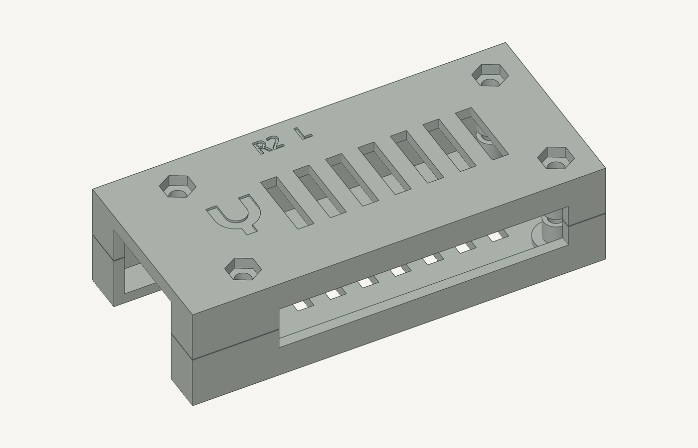
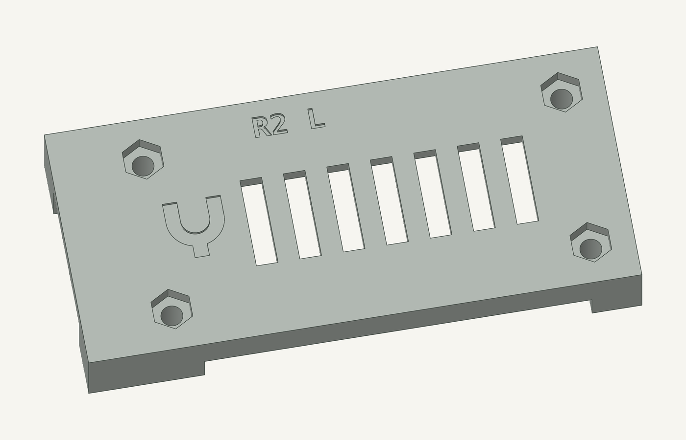

# USB endpoint housing R2 — branded model

R2 applies the [canonical Yoke mark](../../../site/assets/yoke-mark.svg) to the
screw-closed Radxa ZERO 3E V1.2 housing. **R2 has not been sliced, released or
printed.** The R1 print and its released files are separate and unchanged.



The native [OpenSCAD source](housing.scad) imports the R1 mechanical modules
with `use <../housing.scad>`. It restores the shallow R1 identity pockets,
then cuts the new exterior mark and `R2 B` / `R2 L` part IDs. It does not
change board supports, fastener interfaces, cable openings or vents.

| Brand feature | Nominal dimension |
| --- | --- |
| Mark centre, original board XY frame | (9, 15) mm |
| Visible mark | 8 × 8.667 mm |
| Recess depth | 0.45 mm |
| Broad arm/ring/stem width | 2 mm |
| Roof remaining below recess | 1.55 mm |
| Gap to first vent | 3 mm |
| Part IDs | 3 mm text, 0.45 mm recess |

The single-colour recess is intentionally small. No raised badge, colour
change, glued insert or separate logo part is required. The canonical SVG
is imported directly; the CAD contains no redrawn version of its path.



## Files and rebuild

- [housing.scad](housing.scad): parametric native model, using the original
  board coordinate frame. Select `base`, `lid`, `lid-printed`,
  `lid-assembled`, `plate`, `assembled`, `exploded` or `mark` with `part`.
- [base.stl](base.stl) and [lid.stl](lid.stl): finished geometry, IDs `R2 B`
  and `R2 L`. The lid STL uses the same inverted print frame as R1.
- [lid-printed.stl](lid-printed.stl): manufactured lid including the four
  original 0.20 mm sacrificial bore membranes.
- [yoke-usb-housing-r2.stl](yoke-usb-housing-r2.stl): two-part plate, packing
  the base and manufactured lid without retessellation.
- [yoke-usb-housing-r2.contact.json](yoke-usb-housing-r2.contact.json): mesh
  component declarations and prototype bridge allowance; **not a release**.
- [validation.json](validation.json): exact delivered-mesh check and hashes.

From the repository root, with Manifold-enabled OpenSCAD (verified with
2026.09.19):

```sh
python3 hardware/usb-housing/r2/build.py
```

`build.py` requires only the Python standard library and OpenSCAD. It pins
the R1 mechanical source and canonical SVG hashes so either upstream change
requires an explicit review. `--output` writes to a separate directory.

For previews, use a Python environment with `numpy`, `trimesh` and `Pillow`:

```sh
python3 hardware/usb-housing/r2/build.py --renders
```

The previews render the exact STL triangles with depth-tested feature edges;
they are CAD illustrations, not photographs or physical fit evidence.

For independent mesh checking, the environment also needs `manifold3d`:

```sh
python3 hardware/usb-housing/r2/verify.py \
  --rebuild .scratch/housing-brand/rebuild \
  --output .scratch/housing-brand/validation.json
```

All five STL/contact outputs reproduced byte for byte in a clean rebuild.
Each part is a consistently wound, watertight single component; the plate
contains two. Exact Boolean comparison against the released R1 meshes found
zero changed volume outside the exterior ID and mark windows. Outer bounds
are identical, and the four sacrificial membranes have zero symmetric
difference. The 2 mm interior floor/roof surfaces, support posts, seam,
fastener load paths, cable windows and vents remain R1 geometry.

## Assembly and release limits

Follow the original [R1 assembly PDF](../assembly.pdf), interpreting its
`R1 B` / `R1 L` labels as `R2 B` / `R2 L`. Hardware remains four M2.5 × 20 mm
pan-head machine screws and four M2.5 hex nuts. Hand-clear the manufactured
lid membranes with a 3 mm bit before assembly. Snug the screws gently in
alternating corners; preserve the nominal 0.15 mm seam gap. The thin
near-Ethernet post ligaments retain the R1 light-hand-snug / 5 N prototype
trial limit; no qualified tightening torque or load rating is claimed.

The bare-board fit basis, 12 × 7 mm USB-C overmould assumption and exclusions
for PoE HATs, heatsinks, brackets and ingress protection remain R1 limits.
Physical board fit, cable access, retention and thermal testing remain
**NOT RUN**. The vendor board mesh is nonmanifold; this delta check does not
claim a fresh Boolean collision proof against that mesh.

Any future R2 print needs a fresh slice, exact-artifact manufacturing and
assembly review, release and clear-bed authorization. This directory has
no G-code, print manifest, printer dispatch or approval for a second job.
