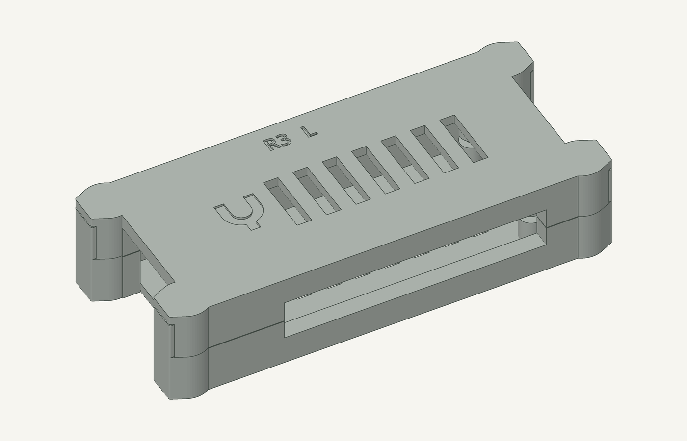
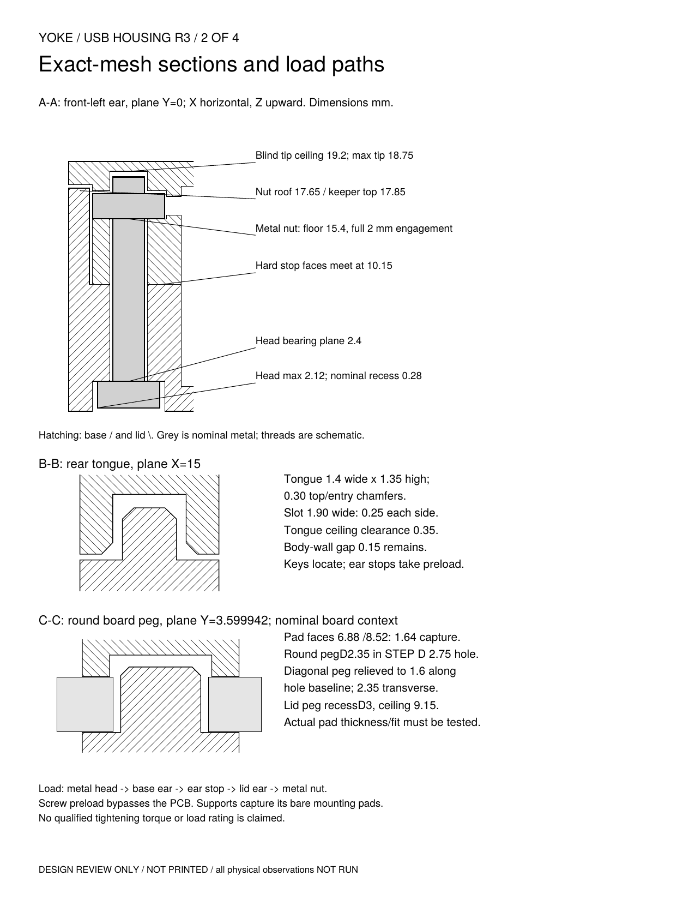
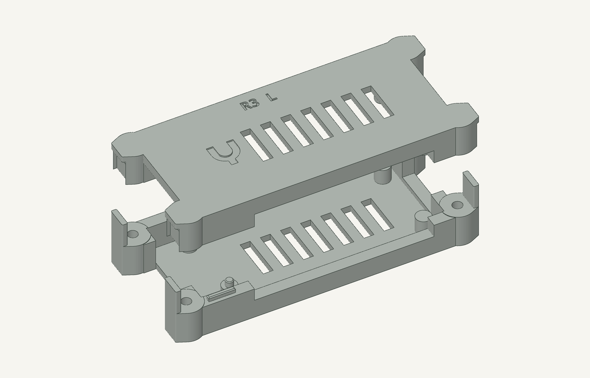

# USB endpoint housing R3

R3 adds a real locating joint, captive **metal** nuts and fully recessed screw
heads to the bare Radxa ZERO 3E V1.2 enclosure. **The first R3 main-plate job
was submitted and verified printing.** See the [dispatch record](print.json).
Physical fit and function remain untested. R1 and R2 files remain unchanged.

**Use M2.5 × 16 mm PH1 pan-head screws, measured under the head. Do not reuse
the R1/R2 20 mm screws: they can bottom in the blind pockets and crack the lid.**
The Ø3 passages are clearance holes; the threads are in the metal nuts.



## Mechanical revision

| Feature | Nominal design |
| --- | --- |
| Central body / maximum ear envelope | 79.6 × 38 × 20 / 90.4 × 39.6 × 20 mm |
| Internal cavity, official board XY frame | x −7…65.4, y −0.4…30.4 mm |
| PCB top / lower and upper pad faces | z 8.5 / 6.88 and 8.52 mm |
| Head well / bearing plane | Ø5.8 mm / z 2.4 mm |
| Nut trap | AF5.25, z 15.4…17.65 mm, side loading |
| Blind screw-tip ceiling | z 19.2 mm; 0.8 mm exterior cap |
| Ear stop faces / body wall gap | z 10.15 mm / 0.15 mm |
| Three tongues | 1.4 mm wide × 1.35 mm high; lengths 8, 10, 10 mm |
| Tongue fit | 0.25 mm per side/end, 0.35 mm ceiling gap, 0.30 mm lead-ins |
| Board locators | Ø2.35 round peg and 2.35 × 1.6 mm relieved diagonal peg |
| Official STEP mounting-hole diameter | 2.75 mm; round-peg radial allowance 0.20 mm |

The end ears keep the case narrow while providing material around the head
wells and nut seats. The minimum nominal head-well-to-cavity wall is 1.3 mm;
the bearing column above the head seat is 7.75 mm. The Ethernet port cutter
acts on the end wall, without cutting the board-support posts. The front
cable bay remains clear of the new fastener axes.

The three chamfered tongues register the halves in XY. Ear stops take screw
preload while the original pad coordinates provide a nominal 1.64 mm board
capture gap. The round peg locates one mounting hole; the second peg is
relieved **along** the diagonal hole-centre line to accommodate centre-distance
variation. The lid provides receiving recesses for both pegs. Actual board
thickness and fit remain unmeasured; screws must never pull an interfering
board into position.

Each nut slides into a roofed trap from the outboard end of the lid. Integral
base fingers close those exits when the halves seat. The nuts then remain
captive even with the screws removed. **Keep the lid level over a tray during
opening: the exits reopen before the lid is fully detached.** A blunt 1.2 mm
pin through the inner service hole can push a nut out with the lid removed.
No extra keeper part, printed thread, adhesive or heat-set insert is used.

Before fitting the board or screws, test the coupon/empty case over a tray:
hold the stops fully seated and gently rotate through six orientations.
Require all nuts retained and restrained against free rotation, then reopen
level to check controlled release. This physical test remains **NOT RUN**.



The canonical [Yoke mark](../../../site/assets/yoke-mark.svg) is imported
directly, recessed 0.45 mm at an 8 mm visible width. Parts carry `R3 B` and
`R3 L` identification. The original 3 × 13 mm vents remain open.

## Hardware and assembly

Use four M2.5 × 16 mm PH1 pan-head screws and four M2.5 hex nuts. The
[Accu screw specification](https://www.accu.co.uk/phillips-pan-head-screws/174946-SIP-M2-5-16-A4-BL)
gives 16 ± 0.35 mm under-head length, maximum Ø5 × 2.12 mm head and 0.45 mm
pitch. The [manufacturer DIN 934 table](https://www.inoxfasteners.com/wp-content/uploads/2016/11/Catalogo-2014.pdf)
gives M2.5 nut thickness 1.75–2.00 mm, AF5 and minimum corners 5.45 mm.
Measure the actual supplied hardware before use.

The [four-page assembly and test PDF](assembly.pdf) includes exact-mesh
sections, nut loading, hardware inventory, closure and reverse service.
Both halves print outside-face down. Each manufactured half contains four
0.20 mm sacrificial bore membranes: **eight cleanup holes total**.

Hand-clear with a 3 mm, 118° twist bit whose point is at most 1.0 mm long,
using a physical depth stop. Enter from the **mating ear face**: base tip
depth 9.0 mm toward the open head well; lid tip depth 6.5 mm toward the nut
trap. These depths include the drill point. Do not drill through the exterior
lid cap or use a power drill. Support the broad body on wood blocks, leaving
the tall keeper fingers free of drilling loads. Keep the board away and
remove all swarf. Require eight clear 3.0–3.2 mm bores and intact seats/caps.

The PDF defines measured stack checks before assembly: at least 0.30 mm
tip-to-ceiling clearance, 0.45 mm of screw beyond the nut and 0.15 mm of head
recess. Nominal worst specified hardware gives 0.45, 0.65 and 0.28 mm,
respectively. Those numbers do not include print error; measured failure
requires a revised stack, not extra tightening.



## Files and rebuilding

- [housing.scad](housing.scad): standalone native parametric CAD. Select
  `base`, `base-printed`, `lid`, `lid-printed`, `lid-assembled`, `plate`,
  `assembled`, `exploded`, the four `coupon-*` variants, `screw` or `nut`.
- [base.stl](base.stl) / [lid.stl](lid.stl): finished parts. The lid uses its
  inverted print frame; assembly transform is `(x, 30−y, 20−z)`.
- [base-printed.stl](base-printed.stl) / [lid-printed.stl](lid-printed.stl):
  manufactured parts with the removable membranes.
- [yoke-usb-housing-r3.stl](yoke-usb-housing-r3.stl): two-part main plate.
- [yoke-usb-housing-r3-coupon.stl](yoke-usb-housing-r3-coupon.stl): separate
  two-part fit coupon, cut from the actual front-left corner. It includes
  the head well, nut trap, keeper, front tongue and round board peg. Use one
  of the same screws/nuts and clear its two membranes. `CB` / `CL` identify
  its halves. It does not establish full-board fit or strength.
- The companion `.contact.json` files declare exact placed components and
  prototype bridge allowances; they are **not print releases**.
- [validation.json](validation.json): concise hashes and nominal check results.

From the repository root, using Manifold-enabled OpenSCAD (verified with
2026.09.19):

```sh
python3 hardware/usb-housing/r3/build.py
python3 hardware/usb-housing/r3/build.py --output .scratch/housing-r3-author/rebuild
```

The build requires only the standard library and OpenSCAD and preserves the
individual facets when packing plates. To regenerate the PDF and exact-mesh
images, use `--documents` in a Python environment with `numpy`, `trimesh`,
`Pillow` and `reportlab`, plus `pdftoppm`. Documentation transients stay under
the repository’s `.scratch/housing-r3-author/` directory.

## Checks and limits

The nominal checks cover watertight parts, reproducible outputs, assembled
base/lid and metal-envelope clearance, sampled lid/nut/screw insertion, closed
keeper obstruction and conservative official-board component bounds. The
normal Lacuna mesh preflight passes both main and coupon plates with supports
disabled, including bed-contact and layer-support checks. All exported facets
exceed its zero-area threshold. These checks do not constitute a print release.
The vendor board mesh is nonmanifold; it is not a Boolean collision proof, and
samples do not establish continuous collision-free movement.

Physical board/peg/key/nut fit, capture, screw stack, cable access, 5 N trial
retention and 30-minute thermal testing remain **NOT RUN**. The model targets
the bare board, with USB-C overmoulds no larger than 12 × 7 mm. No PoE HAT,
added heatsink, bracket, ingress rating or qualified tightening torque is
included. Follow the PDF’s measurements, test limits and stop conditions.

R3 changes the mechanics and screw length. No R1/R2 approval carries over.
The main plate passed exact-file assembly/manufacturing review and release
before its single recorded dispatch. The coupon has not been sliced or
dispatched. The PDF retains its design-stage preparation status; the dispatch
record records the later print. Any subsequent print needs its own reviewed
exact job, release and authorization for a clear bed.
