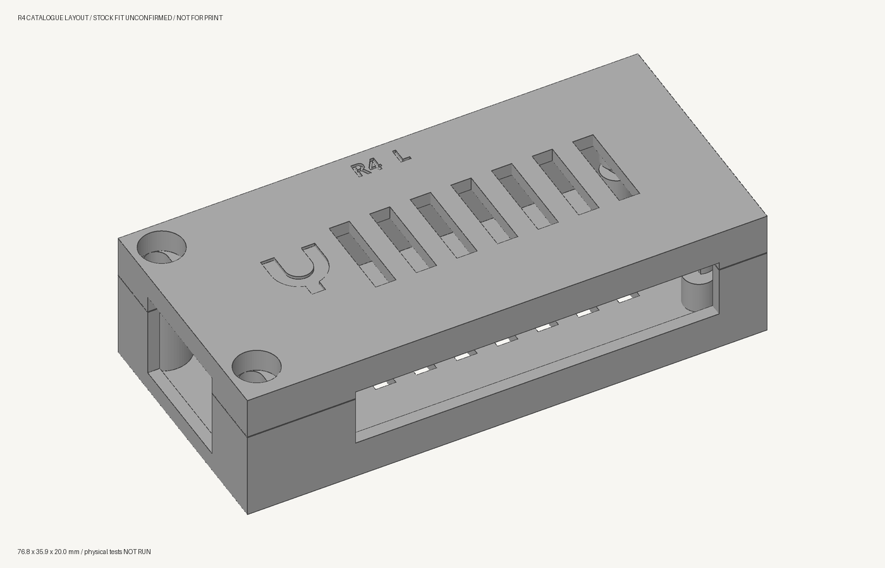
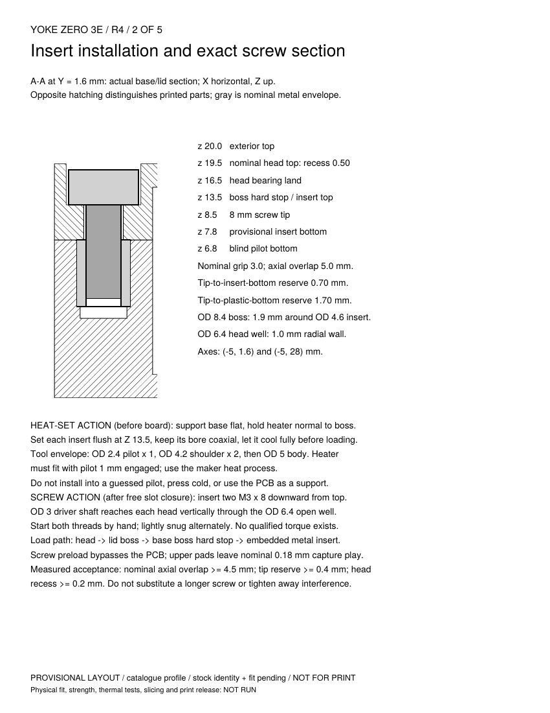
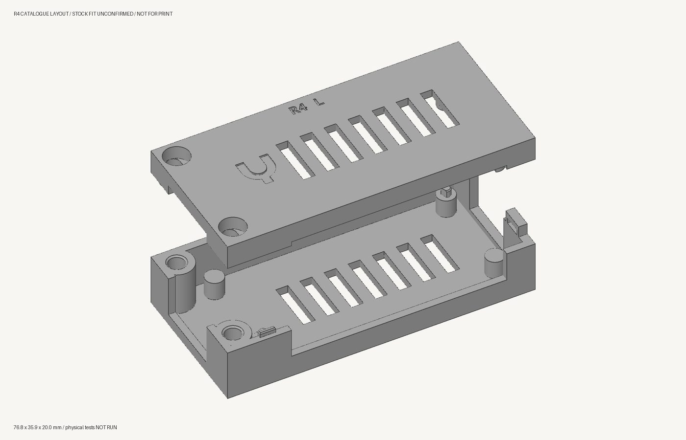

# R4 compact housing — design review

R4 is a **provisional catalogue design**, following the owner's reports of two
failed physical housing prints. It keeps the loaded ZERO 3E inside one flat
**76.8 × 35.9 × 20.0 mm rectangle**, with no external ears or towers. It uses
**two M3 × 8 socket-head screws and two RX-M3×5.7 heat-set inserts**. The lid
**slots together and screws together**: lower it 1.2 mm left of its final
position, slide it right into three guides and two rear retaining pockets,
then install the recessed screws.

**Do not print the full case yet.** The catalogue dimensions are known, but
matching the owner's actual insert stock, measured screw dimensions, coupon
fit and physical assembly remain unverified. No R4 part has been sliced,
released or printed. The next physical question belongs to the small joint
coupons, after stock confirmation and a fresh exact-job review.



## Compact envelope and actual board

The official loaded-board reference occupies x −6.4…65.00165,
y −1.5…30.00553 mm. R4 occupies x −9.2…67.6, y −3.7…32.2 mm; the extra
space supplies the wall, connector clearance and internal fastener material.
It does not put a large bolt margin around the PCB. The two fasteners sit in
the otherwise unused corners beside the RJ45 connector, at (−5, 1.6) and
(−5, 28) mm. No M3 screw passes through the PCB's original Ø2.75 mm holes.

The original four support positions and two relieved locating pegs remain.
PCB lower pad / upper pad faces are nominal z 6.88 / 8.52 mm. The lid's
capture faces are z 8.70 mm, giving 0.18 mm pad play; the case's hard stops
carry screw preload. Tightening must never pull an interfering PCB into place.
Bare board only: no PoE HAT, added heatsink or bracket is included.

## Hardware profile and load path

[hardware.json](hardware.json) distinguishes catalogue facts from unconfirmed
stock. The [Ruthex product page](https://www.ruthex.de/products/ruthex-gewindeeinsatz-m3-100-stuck-rx-m3x5-7-messing-gewindebuchsen)
and [manufacturer RX-series datasheet](https://www.igo3d.com/mediafiles/Sonstiges/Ruthex/ruthex_Datenblatt_RX-Serie.pdf)
identify RX-M3×5.7 as Ø4.6 × 5.7 mm, lead-in Ø3.9, recommended pilot Ø4.0,
minimum surrounding wall 1.6 mm (product GE-M3x57-001,
EAN 4260528721146). The nominal boss has 1.9 mm surrounding wall. Pilot depth
6.7 mm is **our design allowance of insert length + 1.0 mm**, not a quoted
manufacturer requirement. Actual insertion fit remains a coupon question.

The FGRUH M3 kit contains the selected M3 × 8 length; one reported sample
head height is 2.9 mm. The CAD's Ø6 × 3 mm head is an envelope assumption,
not measured stock tolerances. No Lacuna stock reservation is claimed.

| Interface | Nominal design |
| --- | --- |
| Boss OD / head well | 8.4 / 6.4 mm |
| Hard stop / insert top | z 13.5 mm |
| Head bearing plane / nominal head top | z 16.5 / 19.5 mm |
| 8 mm screw tip / insert bottom / pilot bottom | z 8.5 / 7.8 / 6.8 mm |
| Plastic grip / axial metal overlap | 3.0 / 5.0 mm |
| Insert-end / plastic-bottom tip reserve | 0.70 / 1.70 mm |
| Nominal head recess | 0.50 mm |
| Three guide tongues | 1.0 mm wide × 1.2 mm high |
| Guide slot side allowance / real wall each side | 0.25 / 0.85 mm |
| Rear tab underlap / root / toe thickness | 0.75 / 1.0 / 0.5 mm |
| Rear pocket / tab width | 4.4 / 3.9 mm |
| Rear pocket side / matching-face vertical allowance | 0.25 / 0.30 mm |
| Receiver roof / remaining rear wall | at least 1.5 / 1.2 mm |

Two flat bearing shelves support each screw head. A **3.4 mm X × 6.4 mm Y
capsule passage** permits those shelves to print as bridges while leaving an
open shank passage. Its narrow X direction provides a positive reverse-slide
stop with the M3 screw installed. There are **zero sacrificial bore skins**.
Both parts print exterior-face down. The insert pilots are open from the
mating side and accessible before the board is installed.

The clamp path is head → lid boss → base boss hard stop → embedded insert;
it bypasses the PCB. Rear matched sloping faces carry opening load into the
receiver, while front screws restrain reverse X travel. Guide walls carry XY
location. Smooth metal meshes establish nominal axial overlap, **not measured
usable thread engagement**, torque capacity or insert pullout strength.



## Build and service instructions

The [five-page assembly and test packet](assembly.pdf) covers the declared
inventory, insert/tool access, exact joint sections, board insertion,
lower-and-slide closure, screw installation, reverse service, and the first
physical tests. All physical observations remain **NOT RUN**.

Set inserts in the empty base, flush with its boss faces; cool them before
loading. The declared heater envelope is a Ø2.4 × 1 mm pilot, Ø4.2 × 2 mm
shoulder, and Ø5 mm body above it. The actual heater must fit that envelope;
use the insert maker's process instructions. The Ø3 mm driver shaft has
straight access through each head well.

Lower the lid level at −1.2 X, then slide +1.2 X until the outer faces align.
It must seat freely before screws are fitted. Start both M3 × 8 screws by
hand and lightly snug alternately; no qualified torque is specified. For
service, disconnect all cables, remove both screws, slide −1.2 X, then lift.
Do not try to lift the engaged rear hooks straight upward.



## Small first-article coupons

The native CAD crops the actual front screw/guide and rear retaining joint;
it does not substitute a generic insert block. The five-part set is
**4.80 cm³ of model material**, approximately 5.9 g at an assumed 1.24 g/cm³,
before any slicer additions:

- `front-base` + `front-lid`: actual insert boss, head shelves, driver access,
  guide, stop height and screw reach. Use one of the same M3 × 8 / RX inserts.
- `rear-base` + `rear-lid`: actual hook and roof/pocket section.
- `rear-jig`: a separate bench fixture whose hard X faces substitute for the
  full case's front-screw restraint during the rear-joint load trial.

Close the rear pair **outside the jig**, then lower the closed pair onto its
2 mm floor. Hard faces at X 55.5 / 67.7 permit at most 0.2 mm relative reverse
travel. Its tall stop wall is 3.0 mm thick. Clamp the jig floor; require loaded stop
deflection ≤0.1 mm and relative X travel ≤0.3 mm, or invalidate the fixture
result. Confirm that the closed pair moves vertically
with less than 0.5 N drag, then apply the declared upward +Z test load through
a padded grip under the exposed lid roof edge at Y 9.1. The packet specifies
5 N for 10 s, three times, and ten assembly/service cycles. Record actual
screw turns, dimensions, forces, gaps and damage. Coupon results do not prove
full-board/cable/thermal fit. No coupon print is currently authorized here.

## Rebuild and check

[housing.scad](housing.scad) is native parametric CAD. [build.py](build.py)
exports source-matched parts and packs unchanged component facets onto full
and coupon layout plates. Normal export refuses the unconfirmed stock profile;
`--provisional` confines its engineering meshes to this repository's `.scratch`.
Only selected review images/PDF are committed; **no R4 print STL or G-code is
published**.

With Manifold-enabled OpenSCAD (used here: 2026.09.19):

```sh
python3 hardware/usb-housing/r4/build.py --provisional \
  --output .scratch/usb-housing-r4
```

For [check.py](check.py), [render.py](render.py) and [document.py](document.py),
use Python with numpy, trimesh, manifold3d, Pillow and reportlab; `pdftoppm`
is also required for the PDF page images. The Lacuna checkout supplies the
normal mesh and sampled-geometry tools. Reproduce with explicit inputs:

```sh
python hardware/usb-housing/r4/check.py \
  --output .scratch/usb-housing-r4 \
  --board-mesh /path/to/exact-reference/board.stl --lacuna ../lacuna
python hardware/usb-housing/r4/document.py \
  --output .scratch/usb-housing-r4
```

To rebuild the board reference, obtain `rs109_pcba.stp` from Radxa's
[official ZERO 3E STEP archive](https://dl.radxa.com/zero3/docs/hw/3e/radxa_zero_3e_3d_stp.zip),
also linked from [Radxa's downloads](https://docs.radxa.com/en/zero/zero3/download).
The URL can change; these SHA-256 hashes pin the reviewed content:

| Input | SHA-256 |
|---|---|
| ZIP | `616fb4e1017a3ca7a1025372ccc018520a7ccd2ba614e2d6454f0782279f6645` |
| `rs109_pcba.stp` | `97b0a1100cb7cb1e0fbd5aed50f8d6b0422b8885580f937163bdd119ceaab4ca` |
| Generated `board.stl` | `1c1268c8af4b1a6c0b07fec07b3b28c6662e5d10c0c1b794c1f1083f31af8f27` |

[reference.py](reference.py) reproduces the original tessellation. The verified
environment was Python 3.14.9, CadQuery 2.8.0, cadquery-ocp 7.9.3.1.1 and
OCCT 7.9.3. Install those CAD packages in a separate development environment;
they are not Yoke runtime dependencies. After extracting the STEP under
`.scratch`, run:

```sh
python hardware/usb-housing/r4/reference.py \
  --step .scratch/radxa/rs109_pcba.stp \
  --output .scratch/usb-housing-r4-reference/board.stl
```

The exporter uses relative deflection 0.05 and angular tolerance 0.1, binary
STL, `relative=True` and `parallel=True`. It verifies both input and output
hashes. The unchanged source frame receives +8.5 Z in the assembly checker.
Use the resulting path as `--board-mesh` above. Another tessellation requires
a deliberate reference/hash review; it is not silently interchangeable.
Neither generator nor checker depends on a hidden R3-cache path.

## Evidence and limits

[validation.json](validation.json) records concise exact-input identities and
nominal results. The [independent mechanical review](review/review.md) and
[review result](review/result.json) record the examined geometry and remaining
physical questions. Both layout plates pass the normal Lacuna mesh preflight with
supports disabled; no zero-area facets remain. Actual base/lid/tool/hardware
paths have no sampled collisions. Each promised guide survives export with
both 0.85 mm walls. The official board is nonmanifold, so its separate actual
surface-edge check supplements the sampled solid checker; those samples show
zero transverse crossings through closure and service.

The initial layout's digital failures caused native geometry changes: the
rear-port roof was opened through the base rim; annular head-well cantilevers
became bridge shelves; receiver end walls and matched lip chamfers supply
print support; an eliminated front guide moved clear of its port; all guide
slots gained actual surrounding material. The first slide also collided with
a USB-C shell, so its front-right upper support was relieved. These were
consequential design findings, not threshold overrides.

Samples cannot prove continuous paths or exclude face-only/containment
collisions. The declared bridge span is nominal engineering judgement until a
physical coupon tests it. Cable engagement, actual insert fit, useful thread
engagement, strength, assembly cycles and 30-minute thermal observation remain
**NOT RUN**. The conservative 75 °C prototype stop is a trial limit, not a
component rating. Independent design review does not replace Lacuna's fresh
exact-job assembly release, toolpath checks or physical observations.
