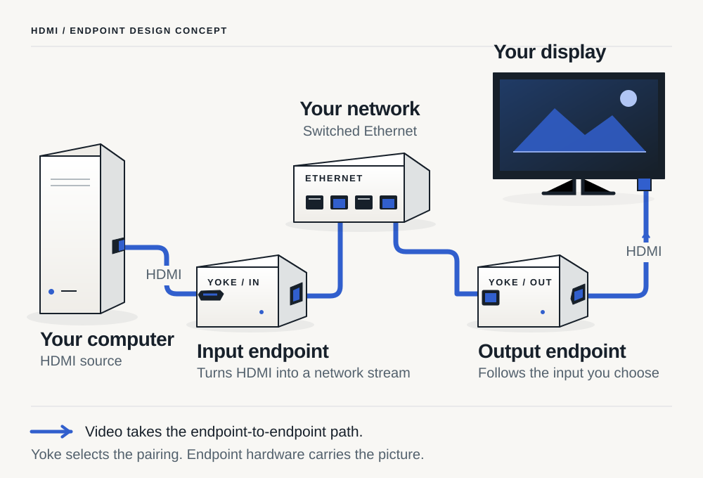

<section class="product-hero">

Yoke USB

<h1>Connect USB devices over Ethernet.</h1>

Plug a USB device into one Yoke box and your computer into another. Connect both boxes to your Ethernet switch. Pair the boxes once; they remember the connection.

<a class="button" href="usb.md">USB hardware →</a><a class="text-link" href="how-it-works.md">How it works ↗</a>

Prototype: Radxa ZERO 3E. USB 2 first. <a href="docs/project-status.md">Development status</a>

<figure id="network-title" class="product-figure"><picture><source media="(max-width: 760px)" srcset="../assets/diagrams/product-scene-mobile.svg"></picture><figcaption id="network-description">Two hardware boxes, with a USB cable at each end.</figcaption></figure>

</section>

<section class="product-section">

USB / HDMI / IR
<h2>Small boxes for the connections you need.</h2>
USB is the first hardware prototype. HDMI and IR boxes are also part of Yoke. Each box works on its own, with management software as an optional addition.

<article class="product-scenario">01 / USB<h3>Use a USB device in another room.</h3>
A box beside the device connects to a second box beside your computer. Both use Ethernet; your computer connects by USB.
<a href="usb.md">USB hardware →</a></article>
<article class="product-scenario">02 / HDMI · Planned<h3>Connect a video source to a screen.</h3>
An HDMI box at each end carries the connection over Ethernet. Choose which source feeds each screen.
<a href="product.md#hdmi">HDMI hardware →</a></article>
<article class="product-scenario">03 / IR · Planned<h3>Control equipment in the cabinet.</h3>
An Ethernet-connected IR box sends signals to the equipment beside it. A two-jack version is planned for use alongside an existing control system.
<a href="product.md#ir">IR hardware →</a></article>

</section>

<section class="product-section">

Pairing
<h2>The boxes remember their pairing.</h2>
Use a command to pair or unpair boxes. Their saved pairing survives a restart or a lost network connection. If the other box goes offline, the pairing stays saved while it waits.

<h3>No running manager required.</h3>
Close the setup tool after pairing. The boxes keep the connection themselves.

<h3>Use your own tools.</h3>
Use the command line, Thermite, or another manager. The commands and protocol are documented.

<h3>Check each box.</h3>
See its saved pairing, connection status, and errors. A separate monitor can listen without changing the pairing.

</section>

<section class="product-section status-snapshot">

Development
<h2>Build the prototype or try the software.</h2>
The USB design uses two Radxa ZERO 3E boards. Software simulations are available now; the complete USB bridge and hardware tests are still being developed.

<a class="button" href="usb.md">USB prototype →</a><a id="doc-search" class="text-link" href="docs/index.md#search">Documentation ↗</a>

</section>
