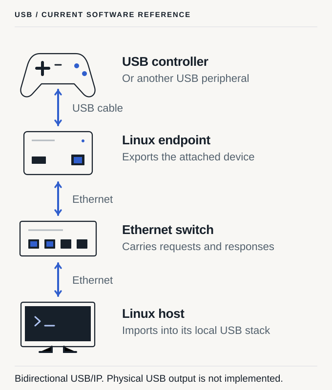

<header class="product-intro"><p class="eyebrow">HDMI / USB / IR</p><h1>Connections, made explicit.</h1>
<p class="hero-lead">Yoke gives each connection a source, a destination, and a pairing the destination remembers. The network carries the traffic; endpoint drivers make the connection happen.</p></header>

## HDMI

### A computer in the closet. A display at the desk.

A video source connects to an input endpoint. An output endpoint connects
to the display. Ethernet joins the two. Pairing selects which source the
display should use; re-pairing gives it another source.

The current software includes a Just Add Power device adapter, a multicast
membership reference, and a supervised GStreamer receiver adapter. Each
uses its backend’s way of selecting a stream. The proposed Yoke hardware
would carry the same idea into dedicated endpoints.

```sh
yoke pair cam-garage tv-den
```

Here `cam-garage` is the source endpoint’s identity and `tv-den` is the
display endpoint’s identity. The destination saves that choice before
acknowledging it. Its driver then attempts the connection.

[Compare the endpoint backends](reference/backends.md) ·
[Read the endpoint hardware design](../../doc/design/EDGE-DEVICES.md)

## USB

### A peripheral here. Its Linux host over there.

Plug a controller or other USB peripheral into a Linux exporting endpoint.
The USB/IP reference lets a paired Linux consumer import that device into
its own USB stack. Applications on that consumer host use the imported
device; USB/IP and the kernel transport its traffic.

<figure class="product-figure product-figure-portrait"><picture><source media="(max-width: 720px)" srcset="../assets/diagrams/usb-reference-mobile.svg"></picture><figcaption>The implemented USB/IP path ends in the consumer’s Linux USB stack. Presenting it through a physical USB port to a separate computer requires a future gadget or proxy backend.</figcaption></figure>

USB devices remain exclusive to one host. Yoke’s reference backend tracks
its own imports and waits for teardown before replacing a connection.
There is no distributed source-ownership protocol in YWP/1; choose a
single authorized consumer for each exported device.

[Understand USB/IP scope](reference/backends.md#usbip) ·
[Read the USB ownership decision](../../doc/decisions/0014-usbip-owned-reconciliation.md)

## IR

### Put the remote-control signal beside the equipment.

The intended IR endpoint would sit near a television, receiver, or other
IR-controlled device and connect by Ethernet. A future routing layer
would deliver the control action to the right endpoint.

IR routing, learning, and transmission are not implemented. The ESP32-S3
firmware contains a separate Ethernet firmware-updater reference;
it provides a foundation for future endpoint work, not a working IR remote.

[See the current capability map](docs/project-status.md) ·
[Explore the ESP32 updater reference](../../doc/design/ESP32-UPDATES.md)

## Keep the tools you choose

Pairing works without Thermite or any other management service. A local
agent owns each endpoint’s saved state. The CLI, terminal monitor, and
read-only metrics exporter are optional views into that system.

Use a manager to organize your equipment, or use the command line directly.
Closing either does not erase the pairing. Agent shutdown and hardware
failure behavior still depend on the endpoint backend.

<div class="hero-actions"><a class="button" href="start.md">Try the software <span aria-hidden="true">→</span></a><a class="text-link" href="how-it-works.md">See how pairing works <span aria-hidden="true">↗</span></a></div>
