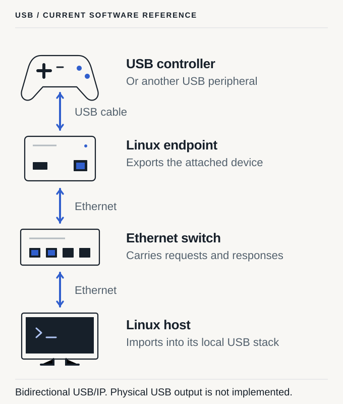

<header class="product-intro">
USB hardware
<h1>A USB box at each end.</h1>

One Yoke box connects to your USB device. A second connects by USB to your computer. Ethernet connects the boxes.
</header>

<figure class="product-figure product-figure-portrait"><picture><source media="(max-width: 760px)" srcset="../assets/diagrams/usb-reference-mobile.svg"></picture><figcaption>The USB prototype uses two Radxa ZERO 3E boards. The computer is separate from both boxes.</figcaption></figure>

## Connect the hardware

1. Plug the USB device into the device-side box.
2. Connect both boxes to your Ethernet switch.
3. Connect the computer-side box to your computer with a USB cable.
4. Pair the boxes with a command or your chosen management tool.

The computer uses its USB connection to the box. Yoke runs inside the boxes. The first version targets **USB 2**; USB 3 is later work.

## Keep or change the pairing

The boxes store the pairing. It survives a restart, a lost network
connection, or closing the management tool. Use a new pair or unpair
command to change it.

Thermite is optional. You can use the command line or another manager
that speaks the documented protocol.

## The prototype

We selected **Radxa ZERO 3E**, with one board in each box. The
case is being revised after two failed prints. The new case must be
rectangular, slot together, and use recessed M3 screws with heat-set inserts.

The hardware is in development. The USB bridge firmware and end-to-end
hardware tests are unfinished. Supported USB devices and computer
compatibility still need testing.

[USB design and firmware work](../../doc/design/USB-ENDPOINT.md) ·
[Development status](docs/project-status.md) ·
[Case redesign](../../doc/design/USB-HOUSING.md)
